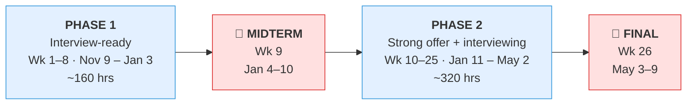

# Syllabus: 26 Weeks, 2 Exams

**Phase 1 goal:** be able to pass an SDE-1/SDE-2 loop at an Indian product company (DSA mediums + machine coding + basic HLD).
**Phase 2 goal:** pass FAANG-level loops and SDE-2 HLD rounds, cover AI-era topics, and build a Java project for your resume.

### How each weekday is split (2 hrs)
| Mon | Tue | Wed | Thu | Fri |
|---|---|---|---|---|
| 60m DSA + 60m HLD | 60m DSA + 60m LLD | 60m DSA + 60m HLD | 60m DSA + 60m LLD | 60m DSA + 60m HLD |

**Sat (5h):** 2.5h DSA + 2.5h LLD build. **Sun (5h):** LeetCode contest/mock + upsolve + weekly test + tracker.

Overall split ≈ **DSA 50% · LLD 25% · HLD 20% · Behavioral/AI 5%**. In Phase 2 this shifts toward system design.

---

## PHASE 1: Interview-ready (Weeks 1–8)

| Wk | Dates | DSA (C++) ~18 problems/wk | HLD | LLD (Java) |
|---|---|---|---|---|
| 1 | Nov 9–15 | Arrays & Hashing, Prefix Sum, Two Pointers | How the web works, latency numbers, back-of-envelope estimation | C# → Java bridge, OOP pillars, interfaces vs abstract classes |
| 2 | Nov 16–22 | Sliding Window, Stack, Monotonic Stack | Scaling: vertical/horizontal, load balancers, stateless services | SOLID (each principle with a code example that breaks it and a fix) |
| 3 | Nov 23–29 | Binary Search (incl. on the answer), Linked List | Caching: strategies, eviction, CDN, Redis | Patterns I: Strategy, Factory, Singleton, Builder, Observer |
| 4 | Nov 30–Dec 6 | Trees: DFS/BFS, BST, LCA, serialization | Databases: SQL vs NoSQL, indexes, replication, sharding | Patterns II: State, Decorator, Adapter, Command, Chain of Responsibility. UML class diagrams |
| 5 | Dec 7–13 | Heaps/Top-K, Intervals, Greedy, Trie | CAP/PACELC, consistency models, consistent hashing | **Machine coding #1: Parking Lot** (90 min, timed) + Java concurrency basics |
| 6 | Dec 14–20 | Graphs: BFS/DFS, Topo sort, Union-Find, Dijkstra | Message queues & Kafka, async processing, API design (REST/gRPC), idempotency | **Machine coding #2: Splitwise** + **#3: Snake & Ladder** |
| 7 | Dec 21–27 *(light: holidays)* | Backtracking + 1-D DP | HLD framework + **Design: URL Shortener, Rate Limiter** | **Machine coding #4: BookMyShow** (seat locking, concurrency) |
| 8 | Dec 28–Jan 3 | 2-D DP, DP on strings, knapsack + **mixed timed sets** | **Design: WhatsApp/Chat, News Feed, Notification System** | **Machine coding #5: LRU Cache + Rate Limiter** (thread-safe) |

**Running alongside Phase 1: job search starts in Week 1** (changed Nov 8: the market is slow and hiring takes months, so start the pipeline now). Budget about 1.5 hrs/week, mostly on weekends.

| Wk | Job-search task |
|---|---|
| 1 | Rewrite the resume (1 page, numbers for impact: latency, users, tickets closed). Update Naukri + LinkedIn (headline "Backend Engineer, Java / .NET", open to work, recruiters only). List 15–20 people for referrals |
| 2 | Send the first referral requests. Refresh Naukri every week (recruiters sort by recent activity) |
| 3–8 | Apply to **~5 "practice-tier" companies per week** (ones you'd accept but aren't your dream). Every interview is a free mock: log the questions you get |
| 9+ (after midterm) | Apply to **dream-tier** companies (FAANG, top unicorns). They have 6–12 month cooldowns, so don't spend those applications before your mediums are solid |

- **Every Sun:** LeetCode Weekly Contest (Sunday 8:00 AM IST). Upsolve at least 1 problem you couldn't finish.

**Phase 1 target:** ~150 DSA problems (pattern coverage, not volume), 5 machine coding builds, 6 HLD designs.

---

## 🎯 MIDTERM (Week 9: Jan 4–10, 2027)

| Paper | Format | Pass bar |
|---|---|---|
| DSA-1 | 2 unseen mediums, 45 min, spoken explanation | Both solved, optimal complexity |
| DSA-2 | 1 medium + 1 medium-hard, 60 min | 1.5 / 2 |
| Machine coding | 90 min, unseen problem (e.g. Elevator / Vending Machine), Java | Runs, extensible, patterns justified |
| HLD | 45 min, e.g. "Design Instagram", using the framework | Requirements → estimates → API → data model → diagram → 2 deep dives |
| Behavioral | 5 STAR stories | Each under 2 min with a clear result |

I'll write the actual exam papers in Week 8.
**Result:**
- **Pass** → start applying to target companies. Phase 2 becomes "level-up while interviewing".
- **Partial** → Phase 2 opens with 2 remedial weeks on the failed papers.

---

## PHASE 2: Strong offer (Weeks 10–25)

| Wk | Block | Content |
|---|---|---|
| 10–11 | Remedial / buffer | Fix midterm gaps (or start the project early if you passed everything) |
| 12–13 | DSA advanced | Advanced graphs (MST, Bellman-Ford, bridges), DP on trees, bitmask DP, interval DP |
| 14 | DSA advanced | Strings (KMP, rolling hash), Segment Tree / BIT (enough for FAANG), monotonic deque |
| 15–16 | HLD classic designs | YouTube/Netflix, Uber/ride matching, Google Docs (collaborative editing), Dropbox, Ticketmaster |
| 17 | Distributed systems | Leader election & Raft (conceptual), distributed transactions, Saga, outbox, CDC, exactly-once |
| 18 | HLD designs | Payment system, distributed job scheduler, search autocomplete, top-K / leaderboard |
| 19 | **AI system design** | LLM fundamentals for engineers, RAG pipeline, vector DBs, LLM gateway (rate limits, caching, fallbacks), evals |
| 20 | **AI-era coding** | AI-assisted coding rounds: specify → generate → **validate**. Debugging & code-review rounds. Reading unfamiliar code fast |
| 21–22 | Java project | Spring Boot service (e.g. a booking or notification system) with Postgres, Redis, Kafka, Docker, and a small AI feature. Goes on your resume and gives you real HLD stories |
| 23 | LLD advanced | Machine coding: Elevator, Chess, Cache with TTL, Pub-Sub, Logger framework. Concurrency patterns |
| 24 | Behavioral | Amazon Leadership Principles, STAR bank (12 stories), "tell me about a conflict/failure", Googleyness |
| 25 | Full mocks | 2 complete loops (DSA ×2, LLD, HLD, behavioral) with peers or Pramp-style platforms |

**Throughout Phase 2:** 10–12 DSA problems/week as maintenance (company-tagged lists for the companies you're interviewing with), weekly contest, 1 HLD design/week.

---

## 🏁 FINAL (Week 26: May 3–9, 2027)

A full FAANG-style loop: 2 DSA rounds (incl. 1 hard), 1 AI-assisted coding round, 1 machine coding round, 1 HLD (SDE-2 bar), 1 AI system design, 1 behavioral.
By then you should have **~350 DSA problems, 10 machine coding builds, 20+ HLD designs, 1 deployed Java project.**

---

## Where the material comes from (what the syllabus is built on)

| Area | Standard references this syllabus follows |
|---|---|
| DSA pattern order | NeetCode roadmap / Striver A2Z ordering (patterns build on each other) |
| HLD | *System Design Interview* vol 1 & 2 (Alex Xu), *Designing Data-Intensive Applications* (Kleppmann), ByteByteGo, Hello Interview |
| LLD | *Head First Design Patterns*, refactoring.guru, common machine coding prompts asked at Flipkart/Swiggy/Uber |
| Behavioral | Amazon Leadership Principles, STAR method |

I write the notes in this folder myself. Use the books and sites when you want to go deeper.
