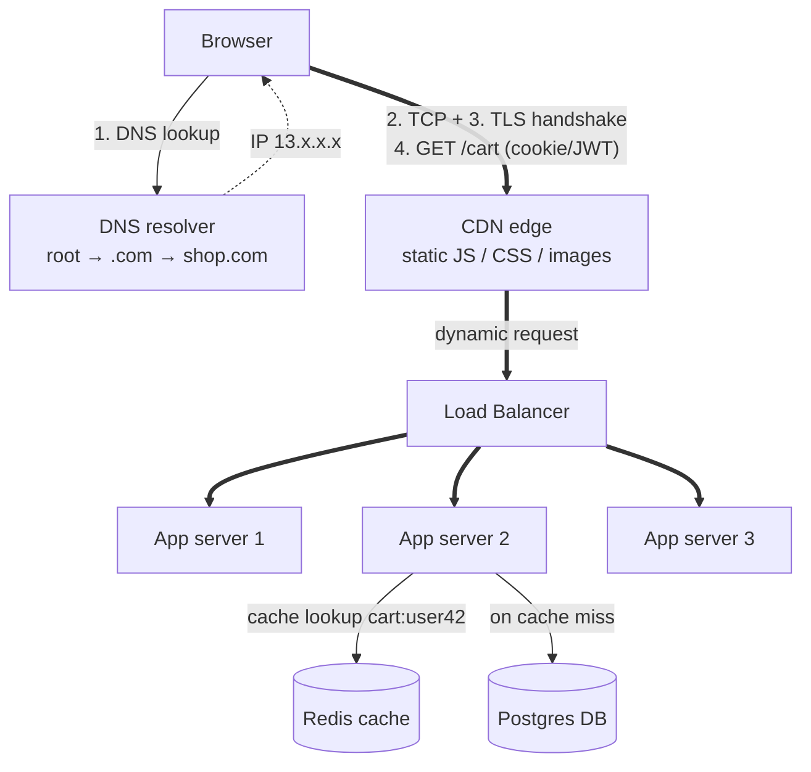

# Week 1 HLD Notes: How the Web Works + Estimation

The goal this week isn't designing systems yet. It's having the **mental model and the numbers** that every later design is built on.

---

## 1. What happens when you type `shop.com/cart` and press Enter

Steps: ① DNS → ② TCP handshake → ③ TLS handshake → ④ HTTP request → ⑤ response → ⑥ browser renders, then fetches assets.

**Things you must be able to explain in 1–2 lines each:**

| Concept | One-liner |
|---|---|
| **DNS** | Turns a name into an IP address. Cached at every layer (browser, OS, resolver), governed by **TTL**. Also used for routing (GeoDNS). |
| **TCP vs UDP** | TCP: reliable, ordered, connection-based (HTTP/1.1, HTTP/2). UDP: fire-and-forget, low latency (video calls, gaming, DNS, QUIC/HTTP/3). |
| **HTTP methods** | GET (read, safe), POST (create), PUT (replace, idempotent), PATCH (partial update), DELETE (idempotent). |
| **Status codes** | 2xx ok · 301/302 redirect · 400 bad input · 401 not logged in · 403 not allowed · 404 · 429 rate limited · 500 server bug · 503 overloaded. |
| **HTTPS/TLS** | Encrypts traffic and proves the server's identity with a certificate. |
| **CDN** | Servers near users that cache static (sometimes dynamic) content, cutting latency and origin load. |
| **Load balancer** | Spreads requests across servers. L4 (TCP level, fast) vs L7 (HTTP level, can route by path/header). |
| **Stateless server** | Keeps no user session in memory, so you can add or remove servers freely. Session lives in a cookie/JWT or Redis. |
| **WebSocket** | A long-lived two-way connection, used for chat and live updates. (More in Week 8.) |

**Your .NET experience fits right in:** your ASP.NET Core API is the "App server" box. IIS/Kestrel behind Azure App Gateway or nginx is the "LB" box. EF Core → SQL Server is the "Database" box. Use these real examples in interviews.

**Exercise:** close this file and draw the diagram from memory. Then write what changes if the user is in India and the servers are in the US. (Answer: latency jumps, so add a CDN and maybe a regional deployment.)

---

## 2. Numbers every engineer knows

Memorize the **order of magnitude**, not exact values.

| Operation | Time | Feel |
|---|---|---|
| L1 cache / CPU op | ~1 ns | instant |
| Main memory (RAM) read | ~100 ns | |
| Redis GET (same datacenter, incl. network) | ~0.5–1 ms | |
| SSD random read | ~100 µs | |
| Round trip within the same datacenter | ~0.5 ms | |
| Simple DB query by indexed key | ~1–5 ms | |
| Read 1 MB sequentially from SSD | ~1 ms | |
| HDD seek | ~10 ms | avoid on hot paths |
| Round trip India ↔ US | ~150–250 ms | users notice this |

**Rules of thumb that come out of this table:**
- Memory ≫ SSD ≫ network ≫ disk seek. **That's why caching works.**
- Cross-continent latency can't be optimized away (speed of light), so you deploy closer to users (CDN, regions).
- A user-facing request should finish in **< 200–300 ms**. Count your network hops.

**Availability ("nines")**
| Availability | Downtime / year | Downtime / month |
|---|---|---|
| 99% | 3.65 days | 7.2 h |
| 99.9% | 8.8 h | 43 min |
| 99.99% | 53 min | 4.3 min |
| 99.999% | 5 min | 26 s |

Components in **series** multiply: 99.9% × 99.9% ≈ 99.8%. Components in **parallel** (redundancy) are much higher, which is why you add replicas.

**Powers of 2 / sizes:** 2¹⁰ ≈ 1 thousand (KB), 2²⁰ ≈ 1 million (MB), 2³⁰ ≈ 1 billion (GB), 2⁴⁰ ≈ 1 trillion (TB).
char = 1 B · int = 4 B · long/timestamp = 8 B · UUID = 16 B · a tweet-sized text ≈ 300 B · a photo ≈ 200 KB–2 MB · 1 min of HD video ≈ 50–100 MB.

---

## 3. Back-of-envelope estimation

Interviewers don't care about precision. They care that you **round confidently and draw a conclusion** ("…so one DB won't be enough; we need sharding").

**The 4 calculations:**
1. **QPS** = daily requests ÷ 10⁵ (since 1 day ≈ 86,400 s ≈ 10⁵ s). **Peak** ≈ 2–3× that.
2. **Storage** = new items per day × size × 365 × years (× 3 if you count replication).
3. **Bandwidth** = QPS × response size.
4. **Memory for cache** = cache the hot 20% of daily reads (the 80/20 rule).

### Worked example: a Twitter-like app
- 100M DAU, each posts 1 tweet/day and reads 50 tweets/day.
- **Write QPS** = 100M ÷ 10⁵ = **1,000/s** (peak ~3k).
- **Read QPS** = 50 × 100M ÷ 10⁵ = **50,000/s** (peak ~150k). **Read-heavy, 50:1 → cache aggressively.**
- **Storage (text)** = 100M × 300 B = 30 GB/day → ~11 TB/year. **Doesn't fit on one machine for long, so plan to shard.**
- **Cache** = 20% × (5B reads/day × 300 B) ≈ 300 GB → a Redis cluster of a few nodes.

### Practice (do on paper Friday, answers in `test.md`)
1. **URL shortener:** 10M new URLs/day, read:write = 100:1, each record 500 B, keep for 5 years. Find write QPS, read QPS, total storage.
2. **Photo app:** 5M DAU, 10% of them upload 2 photos/day, avg 1 MB. Find daily storage and storage after 3 years (ignore replication).

---

## Further reading (optional, if you're curious)
- *System Design Interview* vol 1 (Alex Xu), ch. 1–2.
- ByteByteGo: "What happens when you type a URL into your browser".
