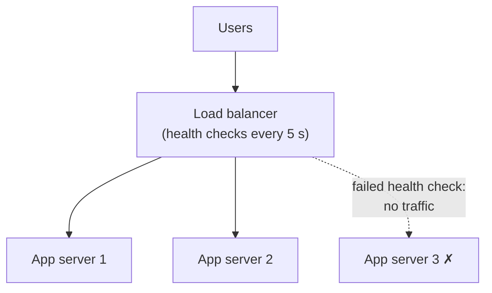
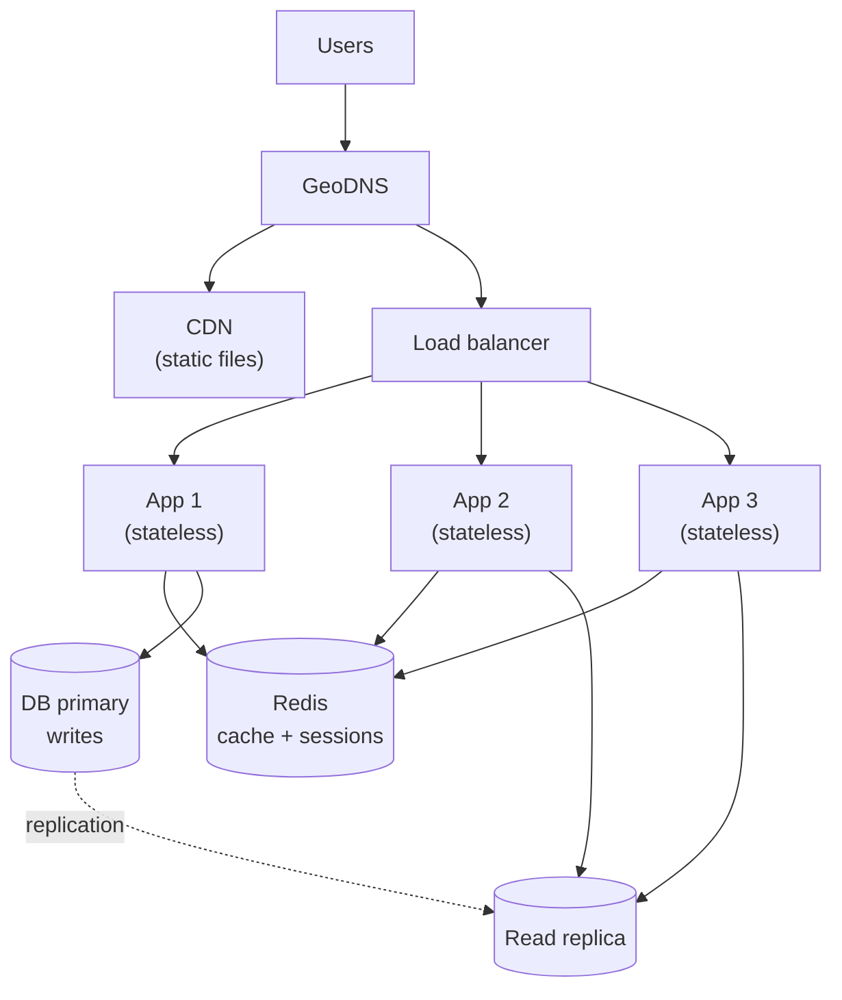

# Week 2 HLD Notes: Scaling, Load Balancers, Stateless Services

Week 1 showed the path of **one** request. This week covers what changes when **a million** users send requests at the same time.

---

## 1. Vertical vs horizontal scaling

Your app runs on one server. Traffic doubles and the CPU sits at 95%. You have two options:

| | **Vertical** (scale up) | **Horizontal** (scale out) |
|---|---|---|
| What you do | buy a bigger machine (more CPU, RAM) | add **more machines** of the same size |
| Analogy | one chef works faster in a bigger kitchen | hire more chefs |
| Code changes | none | the app must be **stateless** (§3), and you need a **load balancer** (§2) |
| Limit | hardware tops out (the largest cloud machines have ~hundreds of cores); cost grows faster than capacity | practically none, you keep adding machines |
| Failure | one machine = **single point of failure (SPOF)** | one machine dies, the others keep serving |
| Downtime to grow | usually a restart | none, add a machine behind the LB |

**In practice you use both:** scale up until it gets expensive, then scale out. Databases are usually scaled **up** first, because scaling a database out (replicas, sharding) is much harder. That's Week 4.

> **Interview answer:** "Vertical scaling is simpler but has a hard ceiling and is a single point of failure. Horizontal scaling needs stateless app servers behind a load balancer, but grows almost without limit and survives machine failures. I'd scale the stateless app tier horizontally and keep the DB vertical until reads force replicas."

---

## 2. Load balancers

A load balancer (LB) sits in front of a group of servers and decides **which server gets each request**. The client only knows the LB's address.

### L4 vs L7

| | **L4** (transport layer) | **L7** (application layer) |
|---|---|---|
| Looks at | IP address + port only | the full HTTP request: path, headers, cookies |
| Can route `/api/*` and `/images/*` to different servers | no | **yes** |
| Speed | faster (doesn't read the request) | a bit slower (must parse HTTP, usually terminates TLS) |
| Example | AWS NLB | AWS ALB, Nginx, Envoy |
| Use when | raw throughput, non-HTTP traffic (databases, game servers) | most web APIs (routing, auth, rate limiting at the edge) |

### Algorithms: how the LB picks a server

| Algorithm | How | Good for | Weakness |
|---|---|---|---|
| **Round robin** | 1, 2, 3, 1, 2, 3, … | identical servers, similar requests | ignores how busy each server is |
| **Weighted round robin** | a bigger server gets more turns | mixed server sizes | weights are set by hand |
| **Least connections** | send to the server with the fewest open connections | requests with very different durations (uploads, long queries) | the LB has to track connection counts |
| **IP hash** | `hash(client IP) % N` | same client → same server (cache locality) | adding a server changes `% N` and reshuffles almost everyone; Week 5's **consistent hashing** fixes this |

### Health checks (recap from Week 1)
The LB calls `/health` on every server every few seconds. After e.g. 3 failures it stops sending traffic there, and after 2 successes it adds the server back. A **shallow** check ("process is up") vs a **deep** check ("I can reach the DB"): a deep check can take *every* server out at once when only the DB is slow, so be careful.

### Isn't the LB itself a single point of failure?
Yes, if there's only one. The fixes:
- **Active–passive pair:** a standby LB takes over the same IP address (a "floating IP") when the active one stops sending heartbeats.
- **Managed cloud LBs** (AWS ALB/NLB) already run on many machines behind one DNS name.
- **DNS with several LB addresses**, one per region (GeoDNS from Week 1).

> **Interview answer:** "An L7 load balancer in front of stateless app servers, least-connections or round robin, with health checks on `/health`. The LB is redundant itself: a managed LB, or an active–passive pair with a floating IP."

---

## 3. Stateless services

### The problem
Server 1 stores Alice's login session **in its own memory**. Her next request goes to server 2 (round robin), and server 2 has never heard of her, so she's logged out.

**State** = any data a server keeps *between* requests (sessions, shopping carts, uploaded files on local disk, in-memory counters).

### Option A: sticky sessions (avoid)
The LB always sends Alice to server 1 (using a cookie or IP hash).
- ✗ If server 1 dies, Alice's session dies with it.
- ✗ Load becomes uneven (one server gets the heavy users).
- ✗ You can't easily remove a server during a deploy, because users are tied to it.

### Option B: move the state out (do this)
The app server keeps **nothing** between requests. Any server can handle any request.

| State | Where it goes |
|---|---|
| Login session | **JWT** in the request (Week 1), or a session ID + **Redis** |
| Shopping cart | Redis or the DB |
| Uploaded files | **object storage** (S3), served through the CDN |
| Rate-limit counters | Redis |

Now servers are **interchangeable**: add 10 more for a sale and remove them after, kill any one of them, deploy one at a time. That's what makes horizontal scaling and auto-scaling work.

> **Interview answer:** "I keep the app tier stateless: sessions in a JWT or Redis, files in S3, so any server can handle any request. That lets the LB use simple round robin and lets us auto-scale and deploy without logging anyone out. I avoid sticky sessions because a server crash loses those users' state."

---

## 4. Putting it together: 1 → 1,000,000 users

Each step fixes the bottleneck of the step before. **Know this order and why each step is needed.** It's the skeleton of most HLD answers.

| Users | Problem | Fix |
|---|---|---|
| ~100 | none | one server runs the app **and** the DB |
| ~1K | app and DB fight over CPU/RAM | **separate DB server** |
| ~10K | one app server is full, and it's a SPOF | **LB + 2 or more stateless app servers** (§2, §3) |
| ~100K | DB overloaded by reads | **cache (Redis)** for hot reads + **read replicas** (Week 3–4) |
| ~100K | images and JS slow for far-away users | **CDN** for static files (Week 1) |
| ~1M | one datacenter = one region of latency and one point of failure; DB writes overloaded | **multi-region** + GeoDNS; **shard** the DB (Week 4); **queues** for slow work (Week 6) |

**Friday task:** close the notes and draw this diagram from memory. Then explain, for each box, **what breaks if you remove it**.

---

## 5. Practice questions (answer out loud, 1–2 minutes each)

1. Your app has 1 server at 90% CPU. Your manager says "just buy a bigger server." When is that the right call, and when isn't it?
2. You moved to 3 app servers and users complain they get logged out randomly. What's the cause, and what are the two fixes? Which do you pick?
3. Uploads take 30 s and API calls take 50 ms, all on the same servers. Which LB algorithm, and why?
4. The deep health check pings the DB. The DB has a 10-second hiccup. What happens to your whole site?
5. Why is `hash(IP) % N` a problem when you add a 4th server?

## New flashcards (add these to your Week 1 deck)

| Front | Back |
|---|---|
| Vertical vs horizontal: the one big downside of each | Vertical: hardware ceiling + SPOF. Horizontal: app must be stateless + needs an LB |
| L4 vs L7 LB | L4 = IP/port only, fast. L7 = reads HTTP, can route by path/header |
| Which LB algorithm for very different request durations? | Least connections |
| Why avoid sticky sessions? | Server dies → its users lose state; uneven load; hard to deploy |
| Where does state go in a stateless design? | JWT or Redis (sessions), Redis/DB (carts), S3 (files) |
