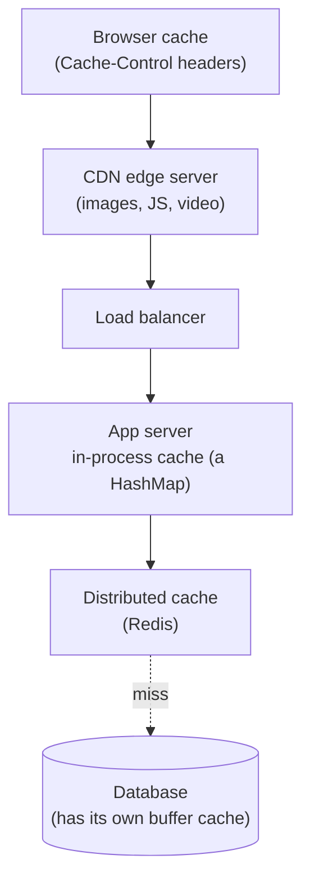
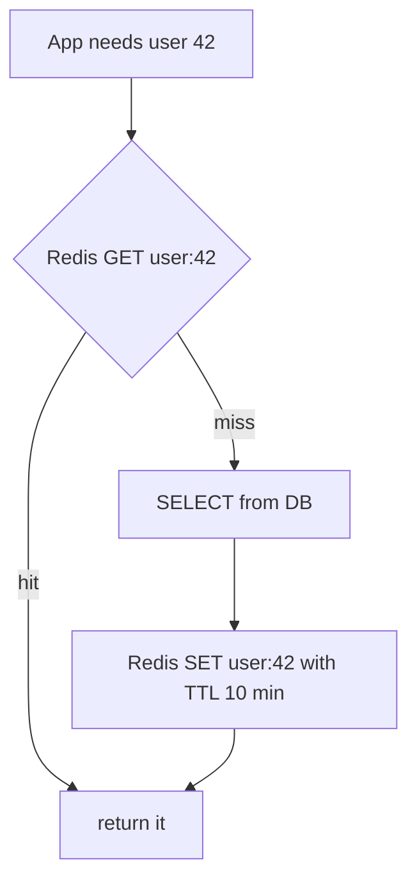

# Week 3 HLD Notes: Caching

Week 2 made the app tier scale: add servers behind a load balancer. But all those servers still query **one database**, and that database is now the slowest and hardest part to scale. A cache keeps answers you've already computed somewhere **faster and closer**, so most requests never reach the database.

---

## 1. Why cache, and where caches live

### The physics (recap of the Week 1 latency numbers)
| Read from… | Takes about | Compared with RAM |
|---|---|---|
| RAM in the same process | 100 ns | 1× |
| Redis on another machine in the same data centre | 0.5 ms | 5,000× |
| SSD | 0.1 ms | 1,000× |
| Database query (network + disk + query work) | 5–50 ms | 50,000×+ |
| Another continent | 150 ms | 1,500,000× |

### The one formula: hit ratio
**Hit** = the data was in the cache. **Miss** = it wasn't, so you went to the DB.

> Average latency = hit ratio × cache time + miss ratio × DB time

Example: cache 1 ms, DB 20 ms, 90% hits → 0.9 × 1 + 0.1 × 20 = **2.9 ms** instead of 20 ms. The DB also gets **10× fewer queries**, which is often the bigger win.

A 99% hit ratio vs 90% isn't "9% better": DB traffic drops from 10% to 1%, so it's **10× less DB load**.

### What's worth caching
| Cache it | Don't cache it (or think very carefully first) |
|---|---|
| read far more often than it's written (product pages, profiles) | written constantly and read rarely (logs) |
| expensive to compute (a feed, a search result, a report) | must always be exact right now (bank balance at payment time, stock left at checkout) |
| a few seconds or minutes of staleness is fine | private data that could leak if the cache key is wrong |

### Where caches live (from the user outwards)

| Layer | Good for | Watch out for |
|---|---|---|
| Browser | static files, one user's data | you can't delete it remotely, so use versioned file names (§4) |
| CDN | static files for everyone, near the user | changes take time to spread (purge) |
| In-process (local `HashMap`) | tiny, hot, rarely changing data (config, country list) | each of your 10 servers has **its own copy**, so they can disagree |
| Distributed (Redis) | shared data: sessions, profiles, counters | one more network hop, and one more system that can fail |

> **Interview answer:** "I'd add a cache when reads far outnumber writes and slightly stale data is acceptable. With a 90% hit ratio the DB sees 10× less traffic. I'd use Redis as a shared cache, because a local cache on each of my horizontally scaled app servers would go inconsistent."

---

## 2. Read/write strategies

The real question is **who updates the cache, and when**.

### Cache-aside (lazy loading): the default, use it unless you have a reason not to

**Write path:** update the DB, then **DELETE** the cache key (don't update it). The next read misses and loads the fresh value.

Why delete instead of update?
- Two writers can race: A writes the DB, B writes the DB, B updates the cache, A updates the cache. The cache now has A's **old** value, forever (until the TTL).
- Deleting is safe in any order: the worst case is one extra miss.
- You don't waste effort caching data nobody reads.

**Pros:** only data that's actually read gets cached; if Redis dies, the app still works (just slower). **Cons:** the first read is always a miss; the app code does all the work.

### The others
| Strategy | How writes work | Good | Bad | Use for |
|---|---|---|---|---|
| **Cache-aside** | write the DB, delete the key | simple, survives cache failure | first read misses | the default for most reads |
| **Read-through** | like cache-aside, but the **cache library** loads from the DB on a miss | app code is cleaner | needs a cache that supports it | same as cache-aside |
| **Write-through** | write the cache **and** the DB together, synchronously | cache is never stale | every write is slower; caches data nobody reads | data read right after it's written (user settings) |
| **Write-back (write-behind)** | write the cache only; flush to the DB **later**, in batches | very fast writes, fewer DB writes | **data loss** if the cache dies before the flush | counters: likes, views, analytics |
| **Write-around** | write the DB only; the cache fills on the next read | doesn't fill the cache with write-once data | recently written data is a miss | logs, uploads that are rarely re-read |

> **Interview answer:** "I'd use cache-aside with a TTL. On a write I update the DB and delete the key, which avoids races between two writers. For a like counter I'd consider write-back with INCR in Redis and a periodic flush, accepting that a few seconds of counts can be lost if Redis crashes."

---

## 3. Eviction, TTL, and the 3 classic cache failures

### The cache is full: what do you throw out? (eviction)
| Policy | Throws out | Note |
|---|---|---|
| **LRU** (least recently used) | the item not touched for the longest time | the usual default. **You'll build it on Sunday (#146)**: hash map + doubly linked list, O(1) for everything |
| **LFU** (least frequently used) | the item used the fewest times | better when some items are always popular; more bookkeeping |
| FIFO | the oldest item added | simple, but ignores usage |
| **TTL** (time to live) | anything older than its expiry | not about space. It **limits how stale** data can get |

Choosing a TTL = answering **"how stale is acceptable?"** A product price: a minute. A profile picture: an hour. A stock quote: a second (or don't cache it).

### Failure 1: cache stampede (thundering herd)
A hot key (a celebrity's profile, the home page) expires. 5,000 requests miss **at the same moment**, all 5,000 query the DB, and the DB falls over.
- **Fix:** let only one request rebuild the key (a lock in Redis: `SET key:lock 1 NX EX 5`) while the others wait briefly or get the old value.
- **Fix:** refresh hot keys **before** they expire, in the background.

### Failure 2: cache avalanche
**Many** keys expire at the same time (for example, all were loaded together at startup with a TTL of 1 hour). One hour later, every request misses at once.
- **Fix:** add random **jitter** to TTLs: 60 min ± 5 min.

### Failure 3: cache penetration
Requests for keys that **don't exist** (`user:99999999`, a bot or a bug). They always miss, so every one of them hits the DB.
- **Fix:** cache the "not found" result too, with a short TTL (30 s).
- **Fix:** a **Bloom filter** in front: a compact structure that answers "definitely not in the DB" or "maybe in the DB".

> **Interview answer:** "LRU eviction with TTLs sized to how stale each kind of data can be. For hot keys I'd prevent stampedes by letting one request rebuild while others serve the old value. I'd jitter TTLs to avoid mass expiry, and cache negative results so missing keys don't hammer the DB."

---

## 4. CDN (Content Delivery Network)

You met CDNs in Week 1 (the local warehouse analogy). Now the details.

A CDN is many **edge servers** around the world. A user in Chennai gets your images from a Chennai or Mumbai edge server instead of your origin server in Virginia: 20 ms instead of 250 ms. Your origin also serves far fewer requests.

| | **Pull CDN** | **Push CDN** |
|---|---|---|
| How content gets there | the edge fetches from your origin on its first miss, then keeps it until it expires | you upload content to the CDN yourself |
| Good for | most websites | big files that rarely change (videos, software downloads) |

**Controlling it with HTTP headers:**
- `Cache-Control: public, max-age=31536000` → anyone (CDN and browser) may cache it for a year.
- `Cache-Control: private, no-store` → never cache it (a bank statement).

**How to ship a new version of `app.js` when every browser cached it for a year?** You don't overwrite it. Give the file a **versioned name** (`app.3f9a2c.js`, the hash of its content) and update the HTML to point to it. The old name simply stops being used. That's **cache busting**. For files whose names can't change, you **purge** them from the CDN, which takes seconds to minutes to reach all edges.

What goes on a CDN: images, CSS/JS, fonts, video segments. What usually doesn't: personalised API responses (each user's are different, so there's nothing to share).

> **Interview answer:** "Static assets go on a CDN with long max-age and content-hashed file names, so deploys never fight stale caches. The origin only serves APIs. For video I'd use the CDN for the segments too, because that's where most of the bandwidth is."

---

## 5. Redis

Redis is an **in-memory** key-value store. Because everything is in RAM, a read takes well under a millisecond (plus the network hop).

### Not just strings: the data structures are why it's used everywhere
| Type | Example commands | Typical use |
|---|---|---|
| String | `SET user:42 "{json}" EX 600`, `GET`, `INCR views:post:7` | cache entries, counters |
| Hash | `HSET user:42 name "Ana" city "Pune"` | an object whose fields you read separately |
| List | `LPUSH`, `RPOP` | simple queues, "latest 10 items" |
| Set | `SADD online_users 42` | unique visitors, tags |
| Sorted set | `ZADD leaderboard 980 "ana"`, `ZREVRANGE leaderboard 0 9` | **leaderboards**, top-K, anything ranked |

Every key can have a TTL (`EX 600`).

### Why `INCR` is safe with 10 app servers
Redis runs commands **one at a time** (a single thread for commands). Two servers sending `INCR likes:7` at the same moment can't both read 5 and both write 6. You get 7. That makes it perfect for counters and **rate limiters** (Week 7).

### Will I lose data if Redis restarts?
By default it's a cache, so you might. Two ways to save to disk:
- **RDB snapshots:** the whole dataset every N minutes. Lose up to N minutes.
- **AOF (append-only file):** every write is logged. Lose about 1 second at most, but slower.

For a pure cache, losing it is fine: the DB still has everything. For sessions or counters, turn persistence on.

### Scaling it
- **Replicas:** one primary takes writes, replicas serve reads, and if the primary dies a replica takes over (Redis Sentinel).
- **Redis Cluster:** splits keys across several primaries by hashing the key (sharding is in Week 4, consistent hashing in Week 5).

### Common uses, the list to have ready
cache · **session store** (Week 2: this is how the app servers became stateless) · rate-limiter counters · leaderboards · distributed locks (with care) · simple pub/sub.

**Redis vs Memcached:** Memcached only does strings and has no persistence, but it's multithreaded. Redis has data structures, persistence and replication. The default answer today is Redis.

> **Interview answer:** "Redis as the shared cache and session store. It's in-memory, so reads are under a millisecond, commands are atomic so INCR works for counters and rate limiting, and sorted sets give me leaderboards for free. For the cache I accept losing data on restart. For sessions I'd enable AOF and run a replica."

---

## 6. Practice questions (answer out loud, 1–2 minutes each)

1. Your product page takes 80 ms and the DB is at 85% CPU. 95% of requests are reads. Walk through adding a cache: where, which strategy, what TTL?
2. With cache-aside, a user updates their name but still sees the old one for 10 minutes. What's the bug in the write path, and the fix?
3. A cricket match ends and the scorecard key expires. The DB spikes to 100% CPU for 20 seconds. Name the problem and give two fixes.
4. You cache user profiles in a `HashMap` inside each of your 8 app servers. What goes wrong when a user edits their profile?
5. Why are like counters a good fit for write-back, and bank transfers a terrible one?
6. You deployed a CSS fix, but half your users still see the broken page for a day. Why, and how do you stop it from happening next time?

## New flashcards (add these to your deck)

| Front | Back |
|---|---|
| Average latency with a cache | hit ratio × cache time + miss ratio × DB time |
| Cache-aside write path | update the DB, then **delete** the key (not update it) |
| Write-back: the risk | data lost if the cache dies before it flushes to the DB |
| Stampede vs avalanche vs penetration | one hot key expires / many keys expire together / keys that don't exist |
| Fix for avalanche | jitter the TTLs |
| Fix for penetration | cache "not found" briefly, or a Bloom filter |
| How to bust a browser/CDN cache on deploy | content-hashed file names (`app.3f9a.js`) |
| Why Redis INCR is safe across servers | Redis runs commands one at a time, so they're atomic |
| Redis sorted set is used for | leaderboards / top-K |
| RDB vs AOF | periodic snapshot (lose minutes) vs log every write (lose ~1 s) |
